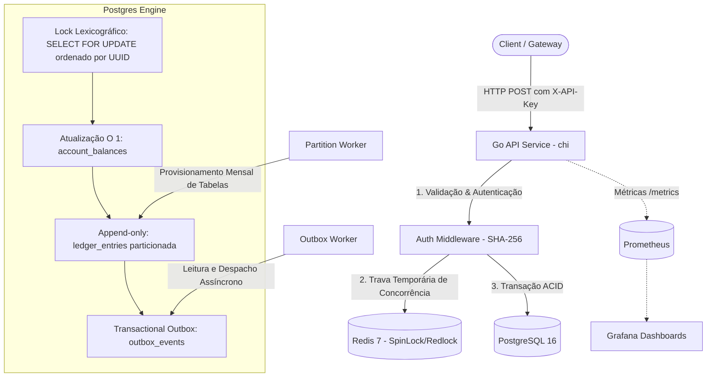

# Fintech Core Engine

[](https://golang.org)
[](https://www.postgresql.org)
[](https://redis.io)
[](LICENSE)

Motor transacional bancário e contábil em Go baseado no princípio de partidas dobradas (*double-entry bookkeeping*). O sistema resolve o problema de consistência estrita de saldos em cenários de alta concorrência e transferências simultâneas, impedindo saldo negativo, condições de corrida e inconsistências financeiras.

---

## 🏗️ Arquitetura do Sistema



---

## ✨ Funcionalidades Principais

- **Partidas Dobradas (*Double-Entry*):** Toda movimentação gera débitos e créditos estritamente balanceados ($\sum \text{Débitos} - \sum \text{Créditos} = 0$). O ledger é imutável (*append-only*).
- **Snapshot de Saldo em $O(1)$:** Consulta direta na tabela `account_balances` sem necessidade de agregação linear da tabela histórica de extrato.
- **Prevenção de Deadlocks (Two-Tier Locking):** Camada 1 distribuída com Redis (Spin-Lock com backoff exponencial) e Camada 2 relacional com `SELECT ... FOR UPDATE` ordenado lexicograficamente por UUID das contas envolvidas.
- **Idempotência Transacional:** Garantia de execução única via cabeçalho `X-Idempotency-Key`.
- **Transactional Outbox Pattern:** Disparo assíncrono de eventos sem risco de estado inconsistente entre banco e mensageria externa.
- **Particionamento Declarativo de Dados:** Tabela `ledger_entries` particionada mensalmente por range de data com worker para provisionamento antecipado de 12 meses.
- **Rotina de Reconciliação Contábil:** Validação em background que compara o saldo snapshot atual com a soma do histórico de lançamentos.

---

## 🛠️ Stack Tecnológica & Decisões Técnicas

| Componente | Tecnologia | Decisão Técnica |
| :--- | :--- | :--- |
| **Linguagem** | Go (Golang 1.24) | Modelo de concorrência com goroutines leves, footprint de memória baixo, tipagem forte e compilação nativa para baixa latência. |
| **Banco Principal** | PostgreSQL 16 | Confiabilidade ACID, suporte a particionamento nativo por range de datas e controle de concorrência granular via `FOR UPDATE`. |
| **Lock Distribuído** | Redis 7 | Resposta sub-milissegundo em memória para amortecer picos de requisições sobre a mesma conta antes de atingir o banco relacional. |
| **Roteamento HTTP** | Chi Router | Roteador idiomático, compatível com a biblioteca padrão `net/http` e com overhead mínimo de alocação de memória. |
| **Métricas** | Prometheus + Grafana | Exposição nativa de latência, taxa de reconciliação e volumetria de transações via endpoint `/metrics`. |

---

## 🚀 Como Rodar o Projeto

### Pré-requisitos
- [Docker](https://docs.docker.com/get-docker/) e [Docker Compose v2+](https://docs.docker.com/compose/)

### 1. Inicializar o ambiente completo
```bash
docker compose up -d --build
```
Isso iniciará:
- **API Go**: `http://localhost:8080`
- **PostgreSQL**: `localhost:5433` (externo) / `5432` (interno)
- **Redis**: `localhost:6379`
- **Prometheus**: `http://localhost:9090`
- **Grafana**: `http://localhost:3000` (admin / admin)

### 2. Verificar a saúde da API
```bash
curl -s http://127.0.0.1:8080/health
```
Resposta esperada:
```json
{
  "engine": "enterprise-core-ledger",
  "status": "healthy",
  "version": "2.3.0"
}
```

---

## 🧪 Como Rodar os Testes

### Testes Unitários
```bash
go test -v -race ./...
```

### Teste de Carga e Concorrência (*Stress Suite*)
A aplicação possui uma suíte de estresse (`cmd/stress/main.go`) que simula corrida bancária com 50 goroutines simultâneas demandando valor superior ao saldo disponível:
```bash
go run ./cmd/stress/main.go
```
Ou via container:
```bash
docker compose exec api go run ./cmd/stress/main.go
```

---

## 📊 Resultados e Métricas

- **Conservação de Capital:** 100% validada sob 50 disparos simultâneos (zero race conditions, soma das contas conservada no centavo exato).
- **Taxa de Rejeição Controlada:** 33 transações aceitas e 17 rejeitadas por saldo/lock com consistência atômica.
- **Latência de Liquidação (p50, p95, p99):** `TODO: Executar benchmark formal em cluster isolado (k6 / vegeta) e registrar histograma de percentis.`
- **Vazão Máxima Sustentada:** `TODO: Avaliar throughput sob pool distribuído de conexões PostgreSQL.`

---

## ⚠️ Limitações e Próximos Passos

- [ ] Implementar fila de mensageria externa dedicada (ex.: RabbitMQ ou Apache Kafka) como consumidor do worker de Outbox.
- [ ] Implementar autenticação via mTLS ou tokens JWT com rotação de chaves para substituição da API Key estática.
- [ ] Ampliar a cobertura de testes unitários com mocks para a camada de persistência (`repository`).
- [ ] Adicionar suporte a múltiplas moedas no mesmo ledger com taxas de conversão históricas.

---

## 📄 Licença

Distribuído sob a licença MIT. Consulte [LICENSE](LICENSE) para mais detalhes.
